<!-- # Hello, I'm Huzaifa Ahmad 👋
## Passionate Cross-Platform Developer | Flutter Enthusiast | AI/ML Learner

  
  
  

---

  Welcome to my GitHub profile! I'm a dedicated cross-platform app developer focused on building seamless, high-performance applications. I thrive in dynamic environments, constantly pushing my boundaries in software development and staying updated with the latest industry trends.

---

## 🚀 About Me

  Hi there! I'm Huzaifa Ahmad, a passionate developer with a knack for creating efficient and user-friendly applications using Flutter and Android. My journey in the tech world has been driven by an insatiable curiosity and a commitment to continuous learning.

- 🌱 I’m always expanding my knowledge in cross-platform development and exploring new technologies.
- 💼 Currently diving deeper into AI/ML and Python to broaden my skill set.
- 💬 Feel free to ask me about Flutter, Dart, NodeJs, Java/Kotlin, and more.
- 📫 You can reach me at: huzaifaahmad4001@gmail.com.
- ⚡ Fun fact: I'm always up for a challenge and love solving complex problems.

---

## 🛠️ Technologies & Tools

### Languages & Frameworks

  
  
  
  
  
  
  
  
  
  
  

### Tools & Platforms

  
  
  
  
  
  
  
  
  
  
  
  
  

### Areas of Interest

---

## 📚 Currently Learning

- **Flutter:** Exploring advanced techniques and new libraries to enhance app performance.
- **AI/ML:** Delving into machine learning algorithms and data processing with Python.

---

## 📈 GitHub Stats

  
  

---

## 🏆 GitHub Trophies

  

---

## 📫 Connect with Me

  
  
  

---

## 🚀 Let's Collaborate!

I'm always open to interesting projects and collaborations. Feel free to reach out!

---

Feel free to explore my repositories and connect with me if you want to collaborate on a project or just chat about tech!

---

  

 -->

  

  
  
  

  
  
  

<h2 align="center">⚡ Tech I Work With</h2>

<h3 align="center">📱 Mobile</h3>

<h3 align="center">🤖 AI Engineering</h3>

    
  
  
  
  
  
  
  
  

<h3 align="center">⚙️ Backend & Tools</h3>

<h2 align="center">🚀 Featured Projects</h2>

<table>
<tr>
<td width="50%" valign="top">

### 📄 DocChat

**Multi-User RAG Document Assistant**

Upload documents & images, get **cited, grounded answers**. Hybrid search (dense + BM25), MMR, cross-encoder reranking, LLM query rewriting, JWT-secured multi-user backend. Evaluated with Hit Rate@k, MRR & LLM-as-a-judge.

`Python` `FastAPI` `Streamlit` `FAISS` `ChromaDB` `Docker`

</td>
<td width="50%" valign="top">

### 🏠 EstateAI

**House Value Prediction System**

End-to-end ML pipeline with preprocessing, imputation, encoding, Linear Regression vs Random Forest, 5-fold CV. **R² = 0.8164**, served via REST API.

`Python` `Scikit-learn` `Pandas` `FastAPI` `Joblib`

</td>
</tr>
<tr>
<td width="50%" valign="top">

### 🚑 Swift Aid

**Emergency Response System**

Real-time pre-hospital platform with GPS hospital routing and live notifications. Cut critical care delays by up to **70%**, triage speed **+50%**.

`Flutter` `Node.js` `Express` `MongoDB` `BLoC`

</td>
<td width="50%" valign="top">

### 🛒 Commercial & Client Apps

**Flutter / React Native**

Maintained commercial eCommerce & classified platforms (AdForest), built multi-client apps with auth, real-time dashboards and custom UI libraries.

`Flutter` `React Native` `Node.js` `REST APIs`

</td>
</tr>
</table>

## 💼 Experience

| Role                            | Company                     | Period              |
| ------------------------------- | --------------------------- | ------------------- |
| **Associate Software Engineer** | Glixen Technologies, Lahore | Oct 2025 – Present  |
| **Flutter Developer Intern**    | Avisa Dev, Lahore           | Nov 2024 – Mar 2025 |

## 📜 Certifications

  
  
  
  
  

<h2 align="center">📊 GitHub Analytics</h2>

  
  

  

  

  

<h3 align="center">🤝 Let's build something together — <a href="mailto:huzaifaahmad4001@gmail.com">huzaifaahmad4001@gmail.com</a></h3>
